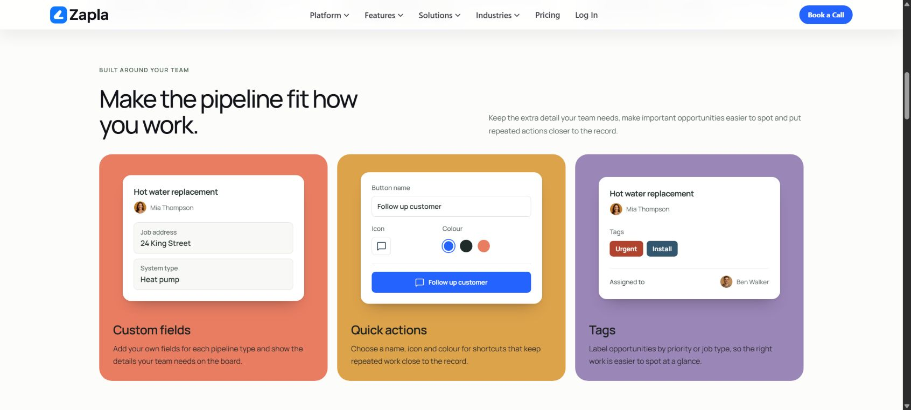
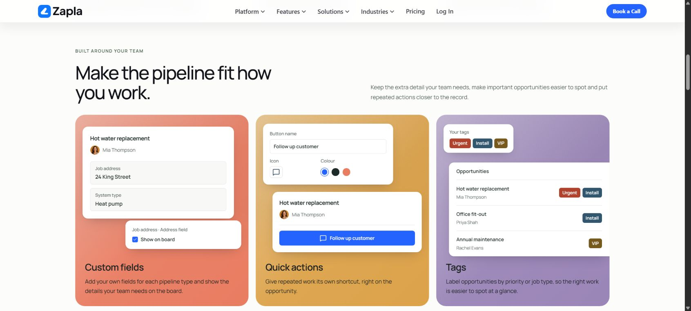

# Pipeline supporting tools: coloured UI scenes

26 October 2026. Scope: the existing three-card customisation section on `/features/pipeline-management`.

## Owner correction and reference judgement

The owner rejected the white, text-heavy cards and requested a filled coloured background on each card, with UI that demonstrates its point. This supersedes the white-card treatment in `405876b`, not the main Pipeline composition or capabilities.

**ADAPT** the supplied ActiveCampaign examples' visual hierarchy: a substantial product scene against a coloured surface, with brief supporting copy. **USE** Zapla's own coral `#E97D62`, gold `#DDA34B`, lavender `#9B86B8`, native typography and existing Mia/Ben portrait identities. **REJECT** the reference's neon yellow, dark-neon page theme, floating pointer, decorative UI fragments and product claims. A simple recolour of the old tiny snippets would not satisfy the request.

## Result and factual limits

- Custom fields: an opportunity shows Job address and System type as readable labelled values. The address continues the earlier prepared example; Heat pump is a prepared field value, not inferred customer information or a live record. The short copy retains per-pipeline-type fields and optional board display.
- Quick actions: a compact configuration shows a button name, icon, selected colour and the resulting custom button appearance. Follow up customer is a custom label. It does not establish a particular underlying action, automatic send, workflow or execution result. The apparent controls are semantic static content, without click handlers, form submission or additional keyboard stops.
- Tags: Urgent and Install appear on an opportunity with Mia's name and Ben's responsibility. They demonstrate human-defined priority/type labels, not automatic classification. Tags stay separate from the pipeline's stage.

The first implementation's verbose headlines were replaced with direct capability titles and shorter outcome copy. UI now leads each card instead of occupying a tiny footer. The surrounding heading, location under the board, route scene, navigation, sales links, indexing and final CTA remain unchanged. No new motion, external assets, runtime dependency or live product call is introduced.

Capability scope follows the owner's supplied tags/action/custom-field screenshots and confirmations in the conversation, the existing section, and the official Pipeline Fields findings recorded in `PIPELINE-ROUTES-CAPABILITIES-20261026.md`. This is a presentation change; no additional live product acceptance test was performed.

## Rendered review

Reviewed the existing section on the actual Lovable preview, then the changed source in the managed local browser. Also compared the rendered Unified Inbox and Automation Builder openings for typography, surface depth, palette and product scale.

- Desktop: three filled panels in one row; smooth white UI leads; short copy sits below. A distinct neutral gap separates this supporting row from the contained dark route chapter.
- Tablet: 834px iframe, 819px content. All three scenes stay readable in one row. Initial independent row sizing misaligned the Tags heading; shared grid rows corrected it. Measured heading positions then matched at 546.45px across all three cards.
- Phone: 390px iframe, 375px content. Inspected the custom-field card and both lower cards. Scenes and copy stack in normal reading order, without interaction.
- Narrow phone: 320px iframe, 305px content. Section and nested card/record geometry checked; document width equals content width. No visible content is horizontally clipped; the only overflow reported belongs to the intentional screen-reader-only icon description.

The new section is rendered as complete static markup and CSS. It uses no effect, state or animation dependency. The whole page's previous reduced-motion/no-JavaScript verification is not reasserted as a new browser test in this scoped change.

## Director and buyer passes

These are distinct role-based assessments by the implementation owner, not claims of independent-agent sign-off or measured conversion results.

- **UI/UX:** one capability per scene; readable values; no interaction needed to understand the point; aligned headings on tablet. White panels retain contrast within saturated fills.
- **Brand/Creative:** exact petal-palette colours, established type/portraits, aligned panels and deliberate filled/white/dark rhythm. No copied AC theme or generic icon tiles.
- **Product Marketing/Conversion:** concrete adaptability proof supports the main stages/ownership story. Shorter copy avoids promoting settings above Pipeline and routes. The quick-action result remains appearance, not an unverified executable behaviour.
- **Motion:** static is appropriate; all three benefits are immediately visible and add no viewing clicks or timing dependency.
- **Owner/frontline and buyer psychology:** the buyer can see which job details are kept, how a shortcut is personalised and how work is labelled. Prepared data is not presented as a customer endorsement or performance result.
- **AI-slop check:** no arbitrary metrics, status badges, numbered steps, giant outline feature icons, decorative connections or floating/tilted objects.

Normal text on the three fills exceeds 4.5:1 after darkening the lavender card's paragraph text. The first review measured that paragraph at 4.45:1 and corrected it before delivery.

## Checks and delivery boundary

Production build, TypeScript, targeted component ESLint, Prettier, SEO policy and whitespace checks are required for the final source. The temporary responsive review page and preview-only host setting are removed before commit. Fetch main immediately before committing; preserve concurrent work and do not rewrite published history. Source sync is through GitHub, with Lovable read-only. No production Publish action is authorised or performed.

## Delivery recovery and deployed review, 27 October 2026

The earlier coloured-card commit remained local, so the supplied Lovable URL still showed the white cards. Recovered the exact revision on current main, retaining the newer Chatbot changes and both appended brief entries. Production build, TypeScript, scoped ESLint, Prettier, SEO policy and whitespace checks passed. The reviewed source tree is `d3c0fa338efbd99435e1e5ab7ada2b12157cde9a`.

Automatic approval review rejected updating main because it requires explicit user authorisation. A separate review branch and [draft PR #202](https://github.com/pugthepug88/guidedpricing/pull/202) preserve the concrete change without updating main or Lovable. GitHub confirms the PR is mergeable. A later Websites change is separate and remains on main.

The exact branch commit `6b743173462e7c7bf059e11f255538b4efe7dd44` passed Workers Builds. [Open the deployed revision](https://d381cd4a-guidedpricing.jinrcao.workers.dev/features/pipeline-management#pipeline-fit-heading). Inspected the actual branch deployment at the normal desktop viewport, 834 by 900 tablet and 390 by 852 phone. All three fills and complete UI scenes appeared; the tablet headings aligned and the phone cards stacked in normal flow. At 320 by 852, document and content widths both measured 305px, and no checked section heading, paragraph, field, record or tag had horizontal text overflow. Viewport overrides were reset. These are scoped section checks, not a renewed whole-page or live-product acceptance test.

The four director passes remain consistent with the earlier assessments: static motion is appropriate; the native Zapla palette, portraits and white UI provide brand continuity; each card demonstrates its named capability; the supporting row stays below stages and before routes. These are the implementation owner's assessments, not independent reviewers or measured conversion results.

Main and the Lovable preview remain unchanged pending explicit approval of that update. No Lovable builder prompt or production Publish action was used.

## Superseding composition correction, 27 October 2026

The owner rejected the repeated centred-panel arrangement and solid fills, then approved a more composed interior with restrained local grain and tonal depth. The outer cards stay aligned; white UI remains opaque and smooth. Fields has an offset opportunity and a compact field-display setting; Quick actions has separate configuration and opportunity shortcut panels; Tags has a label key and three readable opportunity rows. Values and labels are prepared marketing data, not actual customer records, automatic classification or evidence that a shortcut executes a particular action.

Reference decision: ADAPT the supplied Clay screenshots' material depth, varied scale and purposeful UI distribution. USE Zapla's palette, type, portraits and established product surfaces. REJECT heavy noise across the website, neon competitor colours, cursors, decorative movement and invented controls. A texture-only recolour was considered and rejected because it leaves the repetitive composition intact.

Runtime changes are limited to PipelineManagementPage.tsx and pipeline-management.css. The three cards contain no new handlers, effects, submissions, service calls or runtime dependencies. The configured field-display check represents a documented option; the shortcut remains static appearance. Essential content must remain legible without JavaScript or motion. Tablet scenes receive more space instead of miniature UI.

Current main's Automation and Websites changes are incorporated without rewriting branch history. Main, Lovable and production have not been updated by this correction.

### Scoped rendered checks

The exact candidate df82bce9037d63cb3a81d7658a89bd9485141edb passed Workers Builds and rendered at https://fb4eeba2-guidedpricing.jinrcao.workers.dev/features/pipeline-management#pipeline-fit. The normal desktop view was inspected at 1707 by 769, with 1692px document width. All three compositions and their complete copy fit in one view; the field/settings and shortcut panels remain separated, while the tag list deliberately reaches the card edge. No document overflow appeared.

The Browser viewport override did not change the actual page dimensions, so it was reset. A temporary same-origin review frame on the draft branch supplied real 834px tablet, 390px phone, 320px narrow-phone and 1100px desktop-boundary widths at 680px height. All three tablet and phone scenes were visually inspected through native scrolling. At 320px the tag list wraps naturally, complete records fit before the copy, and all checked section headings, paragraphs, fields and tags have no horizontal text overflow. Document/content widths matched: 305px at the narrow width and 1085px at 1100. The tablet changes to three horizontal compositions rather than shrinking the UI; phone keeps the UI above its copy. No new live interaction exists in these scenes.

A contrast review found that grain and a darker gradient under the lavender paragraph could reduce contrast. The correction confines grain to the illustration, removes the dark gradient stop and uses ink copy. The clean lavender base with the final paragraph colour exceeds 5:1; lighter tonal stops increase contrast. The grain fades out smoothly before the copy, rather than ending at a hard edge; on tablets it fades before the copy column. Final deployed confirmation is recorded below. The temporary review page is removed from the final source.

### Director and buyer assessment

These are separate judgements by the implementation owner, not independent-agent approval or measured conversion results. Motion: static content communicates all three features immediately, without timing or extra clicks. Brand/Creative: local fine grain and tonal depth support Zapla's coral/gold/lavender and smooth white panels; the site canvas stays clean. UI/UX: distinct compositions, readable values and source-reviewed complete static content; narrow-screen geometry confirms labels remain visible. Product Marketing/Conversion: fields demonstrate useful job detail, the shortcut sits on the opportunity and tags explain scanning several jobs; settings remain secondary to stages and routes. SME/buyer psychology: practical adaptability is visible without a configuration catalogue. AI-slop check: no cursor hands, fake metrics, floating/tilted decoration, arbitrary connecting lines or new runtime status claims.

### Code checks and limits

TypeScript, scoped ESLint, Prettier, SEO and whitespace checks passed. The managed local build logged completed client and SSR bundles, but did not log the final Nitro completion marker; it is not represented as a complete local build. The exact deployed candidate's Workers Builds check completed successfully. Reduced-motion/no-JavaScript completeness is unchanged static markup, reviewed in source; no browser-level preference or JavaScript-disabled test is claimed. No physical-device, screen-reader or live tenant acceptance test was added. Shared navigation/footer, booking destinations and production publication remain untouched.

### Final deployed confirmation

Final runtime commit `51b64e4a4dc82b59445ad2910f9759099381b30c` passed Workers Builds. [Open the reviewed composition](https://de07ab77-guidedpricing.jinrcao.workers.dev/features/pipeline-management#pipeline-fit). The direct desktop page was opened again and visibly confirmed after the contrast/fade correction. Computed copy colour is `rgb(27, 32, 33)`; the grain's bottom fade is present; the complete three-card scene has no document overflow. This last change affects grain masking only and does not change the responsive geometry checked above.

Current main through `ab4bf8ddfadea129618445d91251c16d9d0c944e`, including the latest Websites funnel/tracking correction, is preserved with a merge parent. The temporary responsive harness is absent from the final source. PR #202 contains the concrete revision for review; shared main and Lovable still await explicit merge authorisation after the earlier automatic approval rejection. No production Publish action was performed.

